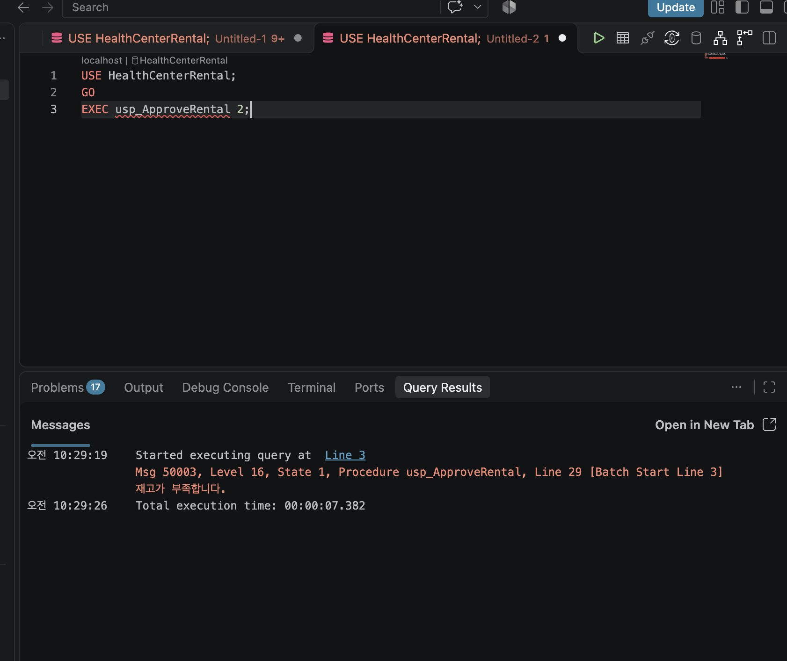
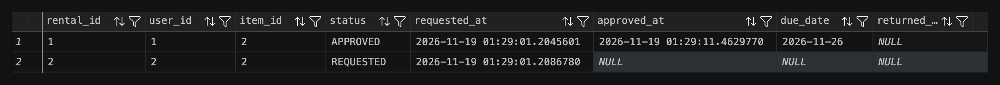
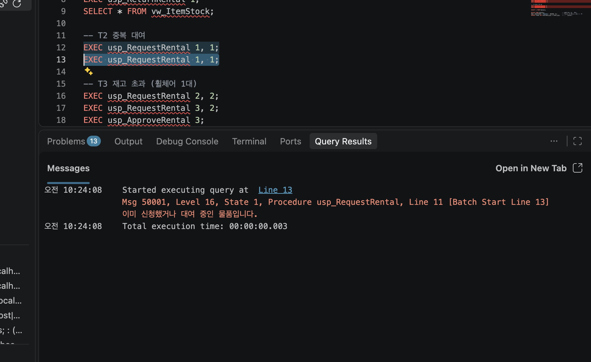
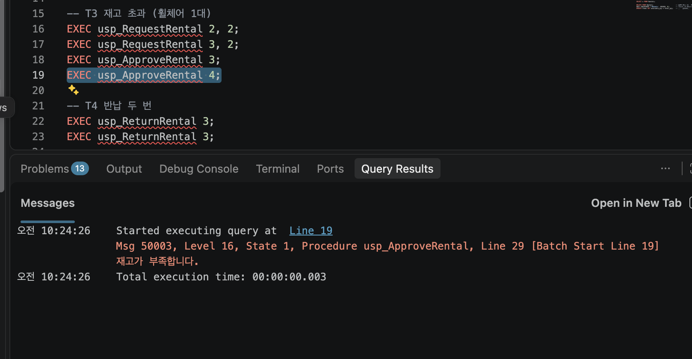
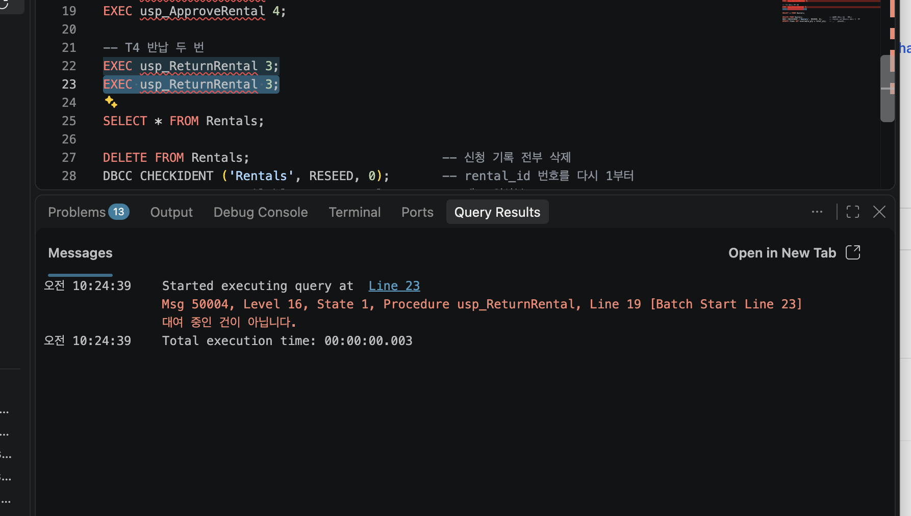

# 보건의료센터 물품 대여 관리 DB

보건의료센터에서 전화 · 방문 신청과 수기 기록으로 관리하던 응급키트 · 휠체어 · 목발 대여 업무를 MSSQL 데이터베이스로 설계한 개인 프로젝트입니다.
업무 규칙을 애플리케이션이 아니라 **데이터베이스 안에서** 저장 프로시저, 제약조건, 트랜잭션으로 보장하도록 구현했습니다.

<p align="center">
  
</p>

## 프로젝트 정보

| 항목 | 내용 |
|---|---|
| 기간 | [2026.11] |
| 형태 | 개인 프로젝트 |
| 개발 환경 | SQL Server 2022 (Docker) |
| 사용 기술 | T-SQL, 저장 프로시저, 트랜잭션, VIEW, 제약조건 |

## 문제 상황

- 전화 · 방문으로 신청을 받고 수기로 기록해서, 누가 무엇을 빌려 갔는지 파악하기 어려웠습니다.
- 같은 사람이 같은 물품을 중복으로 빌리거나, 보유 수량보다 많이 승인될 수 있었습니다.

## 테이블 구조

| 테이블 | 설명 |
|---|---|
| Users | 학생 정보 |
| Items | 물품 정보 (총수량, 대여 가능 수량, 대여 기간) |
| Rentals | 대여 신청 (`REQUESTED` → `APPROVED` → `RETURNED`) |

## 업무 규칙과 구현

| 규칙 | 구현 방법 |
|---|---|
| 같은 물품 중복 대여 금지 | 신청 프로시저에서 검사 + 필터링된 UNIQUE 인덱스 |
| 재고보다 많이 승인 금지 | `available_qty > 0` 조건부 UPDATE + CHECK 제약조건 |
| 승인 · 반납 시 데이터 일관성 | 재고 변경과 상태 변경을 하나의 트랜잭션으로 처리 |
| 동시 승인 충돌 방지 | `UPDLOCK`으로 신청 건 잠금 |

## 테스트 결과

| 테스트 | 기대 결과 | 결과 |
|---|---|---|
| T1 정상 흐름 (신청 → 승인 → 반납) | 재고 차감 후 복구 | 통과 |
| T2 중복 신청 | 50001 오류로 차단 | 통과 |
| T3 재고 초과 승인 | 50003 오류로 차단 | 통과 |
| T4 반납 두 번 | 50004 오류로 차단 | 통과 |
| T5 동시 승인 (휠체어 1대, 2건 동시 승인) | 두 번째 요청이 대기 후 차단 | 통과 |

**T5 동시 승인**: 두 번째 승인 요청이 첫 번째 트랜잭션이 끝날 때까지 약 7초간 대기한 뒤, 재고 부족으로 거부됐습니다.

<p align="center">
  
</p>

<details>
<summary>T2 ~ T4 실행 화면</summary>

**T2 중복 대여 차단**


**T3 재고 초과 차단**


**T4 재반납 차단**


</details>

## 파일 구성

```
├── 01_create_tables.sql   # DB · 테이블 · 인덱스 생성, 샘플 데이터
├── 02_procedures.sql      # 신청 · 승인 · 반납 저장 프로시저
├── 03_views.sql           # 현재 대여 현황, 물품별 재고 VIEW
├── 04_tests.sql           # 예외 상황 테스트
└── images/                # 테스트 실행 화면
```

## 배운 점

- 업무 규칙을 애플리케이션이 아닌 데이터베이스 단에서 제약조건과 트랜잭션으로 보장하는 방법을 익혔습니다.
- 재고 확인과 차감을 **한 문장으로 처리해야** 동시 요청에서도 재고가 맞게 유지된다는 점을 테스트로 확인했습니다.

## 실행 방법

1. Docker로 SQL Server 2022를 실행합니다.
2. SQL 파일을 `01` → `02` → `03` → `04` 순서로 실행합니다.

## 사용 기술

MSSQL (SQL Server 2022), T-SQL, Docker
